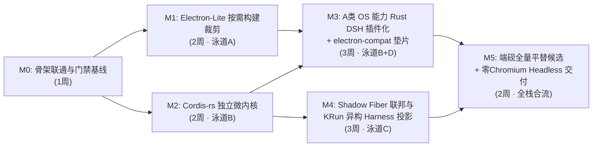

# `electron-cordis` 开发计划（M0–M5）

> **目标**：基于 `cordis-rs` v3 微内核，将 `electron-cordis` 打造为可独立构建和发布的跨平台运行时，兼容 DeepSeek Harness（`dsh`）插件与端砚桌面能力。
>
> **构建机环境与工具链要求**：见 [build-host-requirements.md](./build-host-requirements.md)（可执行 `python3 script/check-build-host.py --tier <headless|canary-pack|chromium-base>` 预检）。

## 1. 总体里程碑与并行泳道

- **泳道 A（Chromium/GN 裁剪）**：GN 条件注册器、`Prebuilt Electron-Cordis Base` 缓存与 C 类模块裁除。
- **泳道 B（Rust 微内核与宿主插件）**：`cordis-kernel`、守护进程、A 类 OS 能力 Rust DSH 插件。
- **泳道 C（DSH 异构联邦与 KRun 投影）**：`cordis-wire`、`@dsh/cordis-bridge`、MCP / `Host Native Contract` / ACP / LLM Gateway 投影。
- **泳道 D（端砚无缝平替集成）**：`@dsh/electron-compat`、`../web` 候选包 `electronDist` 接线与全量回归。

## 2. 分阶段任务与硬验收门禁

### M0：内化 `cordis-rs` 源码、骨架验证与门禁基线（第 1 周）
- **M0.0**：运行 `script/internalize-cordis-rs.sh`，将 `dshbox/cordis-rs` 的 `cordis-core`、`cordis-loader`、`cordis-timer` 源码与 MIT `LICENSE` 内化至 `cordis/crates/`，生成 `cordis/UPSTREAM-CORDIS.json` 溯源记录（零外部 `cordis-*` crates.io 依赖）。
- **M0.1**：为 `script/gen-cordis-build.py` 补齐正反例测试（未知插件、非法 isolation、无 `web-surface` 声明 GN 插件、PDF 依赖断言）。
- **M0.2**：从独立检出的仓库跑通 `cordis/` Rust 工作区的锁定构建与测试。
- **M0.3**：落地 `script/check-inkstone-parity.py`，守卫 Preload 4 对象白名单与 Renderer 零 `KRUN_*` / 零 `ServiceRealm` 泄漏。
- **门禁**：`cordis/Cargo.toml` 中零外部 `cordis-*` 注册表依赖；`gen-cordis-build.py` 测试全绿；`cargo check --workspace && cargo test --workspace` 全绿；`inkstone-headless` 输出 `build_chromium = false`。

### M1：Electron-Lite 模块化裁剪与预构建 Base（第 2–3 周 · 泳道 A）
- **M1.1**：将 `buildflags/cordis_plugins.gni` 接入 `buildflags/BUILD.gn`，向 C++ 导出 `BUILDFLAG(CORDIS_*)`。
- **M1.2**：实现 `script/gen-module-registry.py`，构建期按 Profile 生成 C++ 绑定注册表与 TS `module-list.ts`。
- **M1.3**：裁除 C 类模块（`BrowserView`、`TouchBar`、`inAppPurchase`、`pushNotifications`、`contentTracing`、`netLog`、`ShareMenu`、`ServiceWorkerMain`、`sharedTexture`、`enable_prompt_api`、`enable_builtin_spellchecker`）。
- **M1.4**：产出首个 `Prebuilt Electron-Cordis Base`（macOS arm64 优先，随后 Windows x64），保持 `electron@43` Node ABI 与 `webUtils.getPathForFile` 兼容。
- **M1.5**：在 `../web` 新增完全隔离的并行构建配置（`cordis-mac-candidate-config.mjs` / `cordis-windows-candidate-config.mjs`，输出至 `dist/cordis-*`，独立 `appId`/`stateRoot`/`cordis-canary` 通道），经 `electronDist` 指向 `electron-cordis` Base，**绝不改动原生 `electron@43.2.0` 正式构建与打包脚本**。
- **门禁**：原生 Electron 端砚构建/发布链路零改动且全绿；并行产出的 `electron-cordis` 候选包与原生端砚可同机共存启动，通过 `pnpm test:electron-only`、`pnpm test:e2e:launch`、SSO 隔离登录、PDF/Office 预览、拖拽附件与 `better-sqlite3`。

### M2：独立的 `cordis-rs` 微内核（第 2–3 周 · 泳道 B）
- **M2.1**：在 `cordis-kernel` 落地 `cordis-loader` 装载管线与四域 `ServiceRealm`（`HostRealm` / `UiRealm` / `CoreRealm` / `UntrustedPluginRealm`）。
- **M2.2**：调用方负责隔离环境，通过显式配置的协议端点接入 Electron Cordis。
- **M2.3**：由 Supervisor 管理单写卷锁，确保 UI 重启期间卷锁仍由原进程持有。
- **M2.4**：实现 `cordis-daemon`（Stage A 本地守护进程，UDS / Named Pipe），落地 `UiReadyService` + `AuthSessionService` 两阶段延迟收敛与双咽喉管线（Tool Gateway / LLM Gateway）。
- **门禁**：`UntrustedPluginRealm` 零 fallback 安全单测、Supervisor 卷锁测试和旧内嵌 KRun LoadPlan 拒绝测试通过。

### M3：A 类 OS 能力 Rust DSH 插件化 + 兼容垫片（第 4–6 周 · 泳道 B + D）
- **Batch 1（安全与文件核心）**：`cap-safe-storage`、`cap-clipboard`、`cap-dialog`、`cap-os-shell`（含命令超时、输出上限和工作目录校验）。
- **Batch 2（桌面交互能力）**：`cap-tray-menu`、`cap-notification`、`cap-os-integration`（含双语热重装与启动意图 FIFO）。
- **Batch 3（高成本可选能力）**：`cap-desktop-capture`、`cap-updater`（保留 Full App + Ed25519 Renderer-only 双通道）、`runtime-node-host`。
- **同步交付 `@dsh/electron-compat`**：拦截 `require('electron')` A 类子模块路由至 `cordis-daemon`，每完成一批即从 `profiles/inkstone-desktop.cordis.json` 移除对应 `@dsh/electron-legacy-*` 并剔除 C++ 绑定。
- **门禁**：端砚 `tests/main/auth`、`ssh-hosts`、`language`、更新安全与桌面能力测试全绿；Electron 壳不再链接已下沉模块的 C++ 绑定。

### M4：Shadow Fiber 异构联邦与 KRun 跨 Harness 投影（第 4–6 周 · 泳道 C）
- **M4.1**：实现 `Cordis-over-Wire` 与 `RemoteDshPluginFiber`（`inject` 延迟收敛、`ctx.effect` 双向逆序清理、断连 S3 强杀）。
- **M4.2**：实现 `@dsh/cordis-bridge`（完整兼容 `@deepseek-ai/cordis` API，同时支持宿主机 `runtime-node-host` 与 KRun Guest Node）。
- **M4.3**：实现 4 个投影插件：`bridge-inkstone-tools`（对接 `../core/contracts/native`）、`bridge-mcp`（`/run/krun/dsh-mcp.sock`）、`bridge-acp`（`/run/krun/dsh-rpc.sock`）、`llm-gateway`（`/run/krun/llm-gateway.sock`）。
- **M4.4**：外部 Wasm 宿主可通过同一协议接入，隔离策略由宿主提供。
- **门禁**：同一社区 `@deepseek-ai/dsh-*` 插件 + `@dsh/cap-clipboard` + `Around` 审批护栏，同时在 KRun 内被 `../core`（`inkstone-harness`）、标准 MCP Harness 与 ACP Harness 透明调用，轨迹与热卸载清理一致生效。

### M5：双轨并行灰度稳定、零 Chromium Headless 与全面替换准入（第 7–8 周 · 全栈合流）
- **M5.1**：交付真正零 Chromium 的 `inkstone-headless` 发行包，平替 `pnpm headless:chat` 与 CI 无头测试。
- **M5.2**：落地 Stage B 可选顶层 Rust Supervisor，验证 UI 崩溃重启不中断 VM 内活跃 Turn 与私有卷单写锁。
- **M5.3**：将 `../web/src/main/features/create-features.ts` 首批高内聚 Feature 迁为原生 DSH 插件（通过构建期适配层同时兼容原生 Electron 与 `electron-cordis` 双轨）。
- **M5.4**：评估复用 `../core` 的 `@embedpdf/pdfium` / PDF.js 替代 Chromium 内置 PDF Viewer，彻底裁除 `enable_pdf` + `enable_electron_extensions`。
- **M5.5（双轨并行灰度 & Cutover Gate）**：macOS DMG（arm64/x64）与 Windows NSIS（x64）以独立 `cordis-canary` 通道与原生端砚长期并行构建、同机灰度对比（功能/安全/双通道更新/体积/内存/首屏耗时）；**仅在连续稳定达标后，才执行正式主线全面切换 PR，切换前原生 Electron 构建全程保持可用**。

## 3. 风险与防护

1. **防 Chromium 重编阻塞**：严格执行 Prebuilt Electron-Cordis Base 缓存，日常仅触发 Rust/JS/Wasm 秒级构建。
2. **防阻塞 `cordis-rs` 轮询**：所有 VMM、磁盘 I/O 与 OS 对话框一律进 `tokio::task::spawn_blocking` 或专用 runtime。
3. **防原生 ABI 破坏**：M1–M3 锁定 `electron@43` Node ABI 兼容 `better-sqlite3`，M5 后再评估切 Rust SQLite 插件。
4. **防上游补丁漂移**：全部新代码收敛在 `cordis/`、`js-packages/`、`profiles/`，不向 `patches/chromium/` 塞业务补丁。

## 4. 打包体积优化专项（内置 `bundled` vs 按需 `on-demand`）

`gen-cordis-build.py` 支持在插件条目上声明 `"delivery": "bundled" | "on-demand"`，使同一套源码同时产出**公网轻量首包**与**企业内网离线全量包**。各阶段体积优化归口与预算如下：

| 归属阶段 | 体积优化任务 | 核心瘦身手段 | 预期首包收益（压缩后） |
| --- | --- | --- | --- |
| **M1（GN 裁剪）** | 裁除 C 类模块 + 清理历史双轨残留 | 经 `cordis_plugins.gni` 剔除冗余绑定与 `orbit-*` 遗留产物 | -15 ~ -30 MB |
| **M2–M3（运行时去重与按需插件安装器）** | 实现 `@dsh/plugin-installer`（Ed25519 + 逐文件 SHA-256 + 原子激活/回滚）并将低频原生能力外置 | 剥离默认关闭的 `node-screenshots-*`、`feishu-cli`、Windows `ssh-native` 改为 `on-demand`；统一单份 Node 运行时（消灭 Electron 内置 Node 与 `node-v25.2.1` 双份分发） | -45 ~ -75 MB |
| **M4（重型套件按需化与插件差分更新）** | `science-pack` + `science-mcp` 改造为 `@dsh/plugin-science-pack`（`delivery: "on-demand"`），通过 `InjectSpec` 实现首次触发热装零重启；开启插件级 CAS 增量热更 | 公网首包剥离完整 Python 3.12 科研环境（内网离线 Profile 一键设 `delivery: "bundled"` 保留全量包） | **-80 ~ -200+ MB**（日常更新降至 MB 级） |
| **M5（极限去重与零 Chromium）** | 统一 PDFium（用单一 `@dsh/plugin-pdf` 替代 Chromium 内置 PDF Viewer，彻底关闭 `enable_pdf` + `enable_electron_extensions`）；用 Rust `@dsh/store-sqlite` 替代 `TypeORM + better-sqlite3`；交付零 Chromium `inkstone-headless` | 砍掉 Chrome 扩展引擎 + 双份 PDFium + TypeORM 依赖树与多架构 `.node` prebuild | 桌面端再降 **-20 ~ -40 MB**； Headless 整包 **20–30 MB** |

### 安全与合规门禁
- **纯 JS/TS 与 Wasm (WIT) 按需插件**：走 Ed25519 签名 + SHA-256 清单校验（复用 `RendererUpdateFeature` 模型），不触发 OS 原生签名限制。
- **含原生二进制的按需插件**（`science-pack`、`feishu-cli`、`ssh-native`）：必须使用发布期预签名归档 + 逐文件 SHA-256 核验 + 原子激活，完全满足 macOS Notarize 与 Windows Smart App Control / WDAC 要求。
