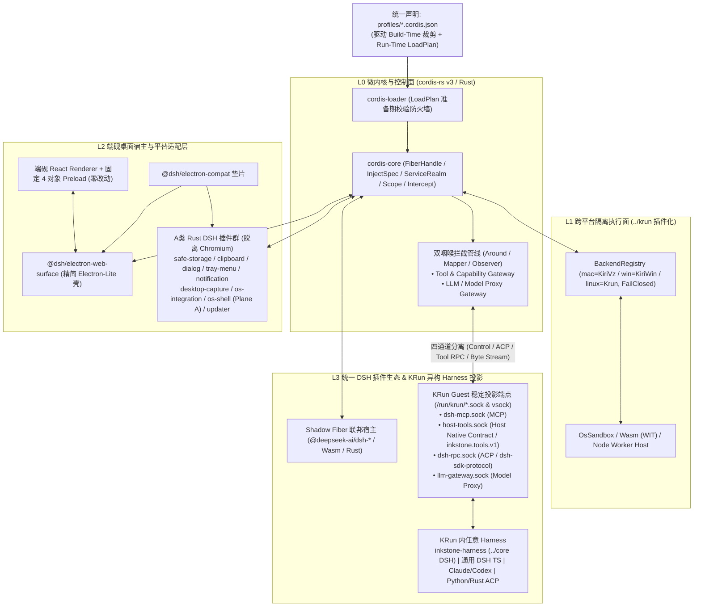

# `electron-cordis` 架构设计：书生·端砚（Inkstone）APP 底座插件化轻量化无缝平替方案

> **目标**：将 `electron-cordis` 改造为基于 `cordis-rs` v3 微内核、深度融合 `../krun` 异构隔离底座、原生对齐 `../core`（`inkstone-harness`，基于 `@deepseek-ai/cordis` + `@deepseek-ai/dsh`）与社区 **DeepSeek Harness (`dsh`)** 插件生态的下一代跨平台桌面与无头运行时，实现对当前端砚桌面底座（`electron@43.2.0` + `../web/src/main`）的**插件化、轻量化、零破坏无缝平替**（**零 Go 运行时依赖**）。

## 1. 现状诊断与 6 条不可违背红线

基于对 `../web`、`../core`（`inkstone-harness`）与 `../krun` 的实盘核查：

1. **当前端砚的真实运行时栈（已完全去 Go 化）**：
   - `../core` 已是纯 TypeScript / Node 24+ 的 `inkstone-harness`，以 `@deepseek-ai/dsh-sdk-minimal` + `@deepseek-ai/cordis` 为入口，产品能力本身就是一组 Cordis 插件（`platform-provider`、`model-transport-plugin`、`checkpoint-plugin`、`context-meter-plugin`、`file-provider-plugin`、`tool-pdf-plugin`、`reviewer-plugin`、`product-skill-provider`、`product-mcp-plugin`、`product-feishu-plugin`），通过 `contracts/native`（Host Native Contract）与 `../web` Main 交互。
   - **现状痛点**：① `../web` 仍依赖全量单体 `electron@43.2.0`（40+ C++ 绑定全量编译），且还要额外单独下载分发一份 Node 24 二进制来跑 `inkstone-harness`；② Preload 实际只用了 `contextBridge`/`ipcRenderer`/`webUtils` 3 个模块，Main 强耦合 Chromium 的仅 7 组绑定；③ 宿主侧（`../web/src/main` 1,960 行 `create-features.ts`）与 Agent 侧（`../core` 的 JS Cordis）尚未统一到同一个跨隔离域的微内核，导致 KRun 中运行的任意异构 Harness 无法透明共用同一套 DSH 插件与宿主能力。
2. **无缝平替 6 条红线**：
   - **Renderer 零改动**：4 个 Preload 暴露对象（`desktopTransport`、`desktopFiles`、`observability`、`__inkstoneDiagnosticsLog`）、TIPC `inkstone-desktop` 协议、`contextIsolation: true` / `sandbox: true` / `nodeIntegration: false` 与 `event.senderFrame === target.mainFrame` 校验零放宽。
   - **状态单写所有权不变**：`app.db`、`profile.db`、`task-state.sqlite`、`science-credentials` 与 VM 内私有卷单写边界绝不双写。
   - **双通道更新与签名完整保留**：Full App Update（含 Windows Handoff）与 Renderer-only Update（Ed25519 + `MAIN_COMPATIBILITY_HASH`）及 `contracts/native` 契约摘要核验不变。
   - **首屏优先两阶段启动不退化**：单实例锁 → `app.db` → 建窗 & `rendererReady()` → 首屏显示 → 后台延迟收敛 `inkstone-harness` / KRun / Science Pack。
   - **Renderer 零 KRun / 零微内核泄漏**：Renderer 永远不可见 `KRUN_*`、`vsock`、`ServiceRealm` 或宿主绝对路径。
   - **安全 FailClosed 原则**：缺虚拟化驱动、未知插件/契约摘要不匹配或越权声明一律拒绝，禁止静默降级隔离等级。

## 2. 目标总体架构

## 3. 已锁定的默认架构选型（P0–P1）

1. **纯 Rust + Node/TS（零 Go 依赖）**：全栈收敛为 Rust（`cordis-rs` 微内核 + `../krun` + A 类宿主能力插件）+ 精简 Chromium（`electron-web-surface`）+ TypeScript/Node（`../core` `inkstone-harness` 及社区 `@deepseek-ai/dsh-*` 插件）。
2. **PDF 预览双轨策略**：P0 平替期在 `inkstone-desktop` Profile 中以可选 GN 插件 `@dsh/electron-pdf-viewer` 保留 Chromium PDF 预览（确保前端零改动），在 `inkstone-headless` / 极简 Profile 中默认关闭；中期可与 `../core` 已有的 `@embedpdf/pdfium` / PDF.js 方案合流，彻底关闭 `enable_pdf` 与 `enable_electron_extensions`。
3. **Stage A 内核接入形态**：`cordis-rs` 微内核作为**独立本地守护进程（UDS / Windows Named Pipe）**运行，延续 `../krun` 窄对接形态，并平滑演进到 Stage B（Rust 顶层 Supervisor 按需拉起 Electron-Cordis UI，Headless 零 Chromium）。
4. **内核源码内化与 `../krun` 复用**：将 `dshbox/cordis-rs` 的 `cordis-core`、`cordis-loader`、`cordis-timer`（MIT）**直接源码内化至 `cordis/crates/`**，作为仓内自有核心 crate 持续演进，不依赖外部 crates.io 版本；同时通过 Cargo `path` 直接依赖兄弟目录 `../../krun/crates/*`。

## 4. 能力分类与按需构建（A / B / C）

- **A 类（脱离 Chromium 的 OS 能力 → 纯 Rust DSH 插件）**：`@dsh/cap-safe-storage`、`@dsh/cap-clipboard`、`@dsh/cap-dialog`、`@dsh/cap-tray-menu`、`@dsh/cap-notification`、`@dsh/cap-desktop-capture`、`@dsh/cap-os-integration`、`@dsh/cap-os-shell`（Plane A S1–S6）、`@dsh/cap-updater`、`@dsh/runtime-node-host`。
- **B 类（Chromium 渲染内核 → GN 条件编译插件）**：必选最小基座 `@dsh/electron-web-surface`（7 组 Browser 绑定 + 3 组 Renderer/Preload 绑定）+ 可选 GN 插件（`@dsh/electron-pdf-viewer`、`@dsh/electron-net`、`@dsh/electron-printing`、`@dsh/electron-extensions`、`@dsh/electron-spellcheck`）。
- **C 类（默认裁除）**：`BrowserView`、`TouchBar`、`inAppPurchase`、`pushNotifications`、`contentTracing`、`netLog`、`ShareMenu`、`ServiceWorkerMain`、`sharedTexture`、`enable_prompt_api`。

## 5. 五阶段无缝平替路线图

- **P0**：落地 `buildflags/cordis_plugins.gni` 与 Profile → `args.gn` 生成器，建立 `inkstone-desktop` / `inkstone-headless` / `dsh-studio` 三套标准 Profile，验证 `electronDist` 平替。
- **P1**：在 `cordis/` 建立 `cordis-rs` v3 + `../krun` 插件化微内核，落实 `ServiceRealm`（`HostRealm` / `UiRealm` / `CoreRealm` / `UntrustedPluginRealm`）、两阶段延迟收敛（`UiReadyService` + `AuthSessionService`）、`update()` vs `era_swap()`。
- **P2**：分批下沉 A 类 OS 能力为 Rust DSH 插件，提供 `@dsh/electron-compat` 垫片实现端砚业务零改动穿透。
- **P3**：实现 `Cordis-over-Wire`、`Shadow Fiber`、`@dsh/cordis-bridge` 及 MCP / `inkstone.tools.v1`（对接 `../core/contracts/native`）/ ACP / LLM Gateway 投影插件，使 `inkstone-harness` 及 KRun 内任意异构 Harness 透明复用全量 DSH 插件。
- **P4**：渐进将 `../web/src/main/features/*` 迁出 `create-features.ts` 成为原生 DSH 插件，交付真正零 Chromium 的 `inkstone-headless` 发行包。

## 6. 双轨并行构建与灰度切换策略（零侵入原生 Electron）

在 `electron-cordis` 全面稳定前，**原生 Electron（`electron@43.2.0`）端砚构建链路与 `electron-cordis` 构建链路严格保持双轨并行**：

1. **官方原生构建零改动**：不修改 `../web/electron-builder.yml`、`../web/package.json` 中的 `electron: "43.2.0"` 依赖、`scripts/build-app.mjs` 及正式 `package:mac:*` / `package:win:*` 流水线。
2. **独立输出与独立构建入口**：`electron-cordis` 候选构建通过独立的配置与脚本触发（注入 `electronDist` 指向预构建的 `electron-cordis` Base），产物固定输出到隔离目录（`dist/cordis-macos/`、`dist/cordis-win/`），不与原生 `dist/mac_*`、`dist/win`、`dist/direct-*` 冲突。
3. **同机共存隔离（Side-by-Side）**：并行验证期，`electron-cordis` 候选包使用独立 `appId` / 单实例锁 / `stateRoot`（隔离 `app.db`、`profile.db`、私有卷）以及独立更新通道（`cordis-canary`），允许开发者与 QA 在同一台 macOS / Windows 机器上同时安装、并行运行原生端砚与 `electron-cordis` 端砚，互不污染数据与更新。
4. **更新与兼容性摘要隔离**：`MAIN_COMPATIBILITY_HASH` 纳入底座类型标记（`base=electron-cordis`），防止两条轨道的 Renderer-only 热更新包跨底座误装。
5. **全量替换准入门槛（Cutover Gate）**：双轨并行跑满稳定观察期且满足全部硬指标（功能/安全/双通道更新全绿、冷启/内存/体积优于原生基线、macOS & Windows 实机零 P0/P1 回归）后，才通过单次可控 Cutover PR 将正式主线切换至 `electron-cordis`，并保留原配置回退标签。
