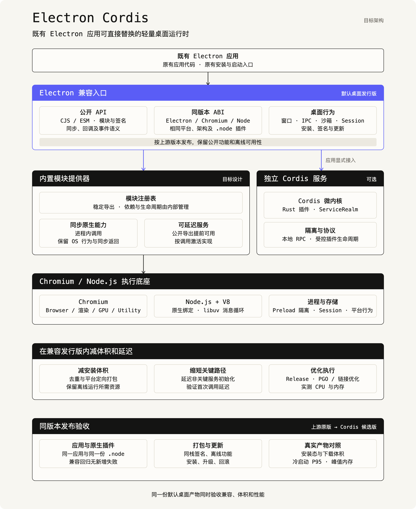
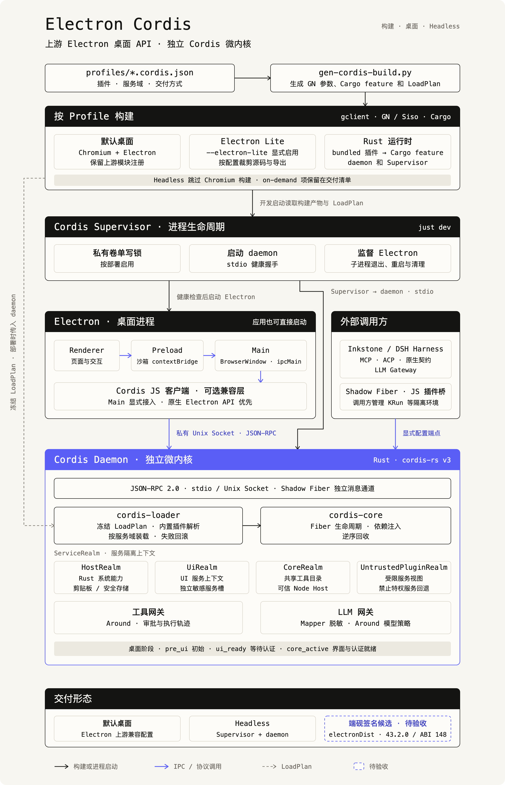
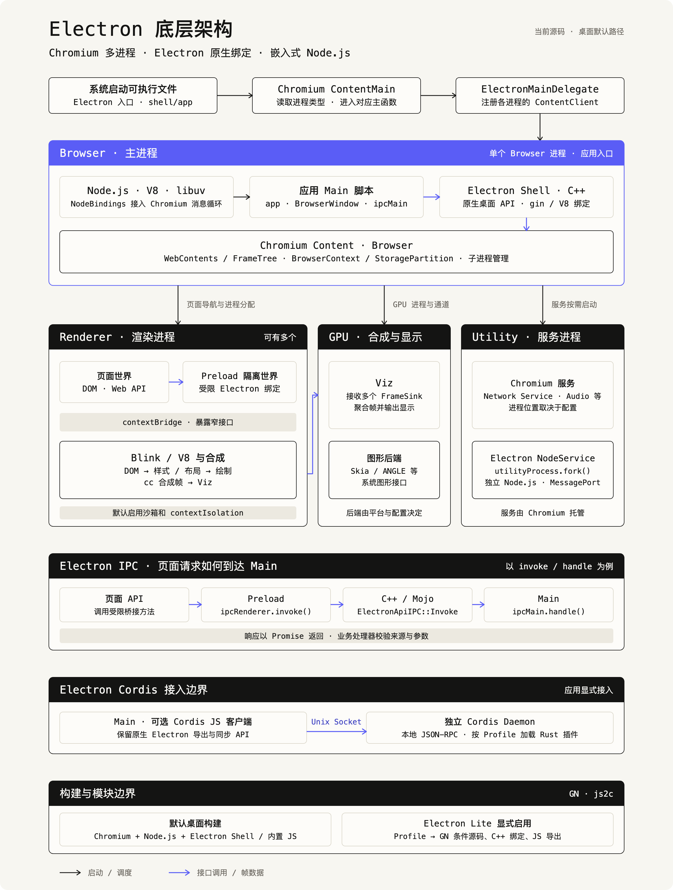

# Electron Cordis 架构设计

首要交付是可在同版本、同平台和同架构下直接替换官方 Electron 的桌面运行时。既有应用沿用原有代码、模块入口、启动参数和原生插件。默认发行版同时以轻量、插件化和高性能为目标，由同一份候选产物接受兼容性、体积与性能验收。

## 目标整体架构

[SVG 矢量原图](./electron-cordis-replacement.svg) · [工程里程碑](./development-plan.md)

## 当前整体架构

Electron Cordis 和 KRun 各自构建、启动和发布。Electron Cordis 提供可显式开启的协议监听端点，调用方可在独立的隔离环境中连接。需要微虚拟机、Wasm 或 OS 沙箱的插件由外部隔离环境负责；内置宿主进程只适用于受信任的本地执行。已生成的内嵌 KRun LoadPlan 需要用更新后的 profile 重新生成。

[SVG 矢量原图](./electron-cordis-architecture.svg) · [构建与发布验收](./development-plan.md)

### Electron 底层架构

[SVG 矢量原图](./electron-runtime-architecture.svg) · [Electron 进程模型](../tutorial/process-model.md) · [Mojo IPC 定义](../../shell/common/api/api.mojom)

## 1. 现状诊断与 6 条不可违背红线

基于对 `../web`、`../core`（`inkstone-harness`）与 `../krun` 的实盘核查：

1. **当前端砚的真实运行时栈（已完全去 Go 化）**：
   - `../core` 已是纯 TypeScript / Node 24+ 的 `inkstone-harness`，以 `@deepseek-ai/dsh-sdk-minimal` + `@deepseek-ai/cordis` 为入口，产品能力本身就是一组 Cordis 插件（`platform-provider`、`model-transport-plugin`、`checkpoint-plugin`、`context-meter-plugin`、`file-provider-plugin`、`tool-pdf-plugin`、`reviewer-plugin`、`product-skill-provider`、`product-mcp-plugin`、`product-feishu-plugin`），通过 `contracts/native`（Host Native Contract）与 `../web` Main 交互。
   - **现状痛点**：① `../web` 仍依赖全量单体 `electron@43.2.0`（40+ C++ 绑定全量编译），且还要额外单独下载分发一份 Node 24 二进制来跑 `inkstone-harness`；② Preload 实际只用了 `contextBridge`/`ipcRenderer`/`webUtils` 3 个模块，Main 强耦合 Chromium 的仅 7 组绑定；③ 宿主侧（`../web/src/main` 1,960 行 `create-features.ts`）与 Agent 侧（`../core` 的 JS Cordis）尚未统一到同一个跨隔离域的微内核，导致 KRun 中运行的任意异构 Harness 无法透明共用同一套 DSH 插件与宿主能力。
2. **无缝平替 6 条红线**：
   - **Renderer 零改动**：4 个 Preload 暴露对象（`desktopTransport`、`desktopFiles`、`observability`、`__inkstoneDiagnosticsLog`）、TIPC `inkstone-desktop` 协议、`contextIsolation: true` / `sandbox: true` / `nodeIntegration: false` 与 `event.senderFrame === target.mainFrame` 校验零放宽。
   - **状态单写所有权不变**：`app.db`、`profile.db`、`task-state.sqlite`、`science-credentials` 与 VM 内私有卷单写边界绝不双写。
   - **双通道更新与签名完整保留**：Full App Update（含 Windows Handoff）与 Renderer-only Update（Ed25519 + `MAIN_COMPATIBILITY_HASH`）及 `contracts/native` 契约摘要核验不变。
   - **首屏优先两阶段启动不退化**：单实例锁 → `app.db` → 建窗 & `rendererReady()` → 首屏显示 → 后台延迟收敛 `inkstone-harness` / KRun / Science Pack。
   - **Renderer 零 KRun / 零微内核泄漏**：Renderer 永远不可见 `KRUN_*`、`vsock`、`ServiceRealm` 或宿主绝对路径。
   - **安全 FailClosed 原则**：缺虚拟化驱动、未知插件/契约摘要不匹配或越权声明一律拒绝，禁止静默降级隔离等级。

## 2. 同版本替换契约

| 范围 | 默认桌面发行版要求 |
| --- | --- |
| 应用与分发 | 启动原有 Electron 应用，保留 `electron` 模块入口、CLI、发行物布局和打包工具接入。保留公开导出、属性描述符、同步和异步语义、异常及事件顺序。 |
| 原生 ABI | 与声明兼容的上游版本匹配 Electron、Chromium、Node、V8、原生模块 ABI、平台和架构。用同一份应用和原生扩展对照运行。 |
| 进程与数据 | 保留 Browser / Renderer / Utility、沙箱、Preload、IPC、Session、系统权限、存储、签名和升级行为。 |
| 内部插件化 | 公开 API 后面由模块注册表管理提供器、依赖和生命周期。兼容性所需的提供器随包交付并支持离线初始化。同步桌面能力保留进程内调用。可延迟能力保留同步可见的导出，并按契约初始化。需要独立执行的 Cordis 服务由应用显式接入。 |
| 体积与性能 | 默认桌面包采用平台定向打包、资源去重、延迟初始化和同版 Release 优化。对照测量下载体积、安装体积、首次交互、首次能力调用、峰值内存和 CPU。停用公开模块的 Profile 单独分发和命名。 |

对照流程先运行 `just verify-desktop <上游可执行文件> <候选可执行文件> [原生插件.node]`，比较版本、主进程 CJS/ESM 导出，以及同步 NativeImage、Session 隔离、Renderer 默认隔离和 Preload IPC。完整门槛还包括上游回归、相同应用离线安装升级、真实原生插件和性能矩阵。端砚采用 43.2.0（ABI 148），当前工程主线为 47 nightly（ABI 154）。 [开发计划](./development-plan.md)

## 3. 已锁定的默认架构选型（P0–P1）

1. **Chromium 桌面底座与 Rust 插件运行时**：Chromium 和 Electron 保留 C++ / Node.js 运行环境，Cordis 提供 Rust 微内核和 TypeScript/Node 协议客户端。
2. **PDF 预览**：兼容桌面发行版保留上游 PDF、打印和扩展行为。应用专用 Lite Profile 可单独配置相关能力。
3. **运行形态**：原版应用直接启动 Electron 入口。显式接入 Cordis 的应用可由 Rust Supervisor 编排 UI 和独立的 `cordis-daemon`。Headless 发行包省略 Chromium。
4. **独立构建**：`cordis-core`、`cordis-loader`、`cordis-timer`（MIT）维护在 `cordis/crates/`。单独检出本仓库即可运行 `cargo build --locked --workspace --manifest-path cordis/Cargo.toml`。

## 4. 能力分类与按需构建（A / B / C）

- **A 类（独立的 OS 能力）**：兼容桌面版通过进程内提供器保留原版剪贴板、安全存储和对话框等 API。显式接入 Cordis 的应用可以调用 Rust DSH 能力，例如 `@dsh/cap-safe-storage`、`@dsh/cap-clipboard` 和 `@dsh/cap-dialog`。替换内置提供器须逐项验证同步语义、错误、权限及原生对象行为。
- **B 类（依赖 Chromium 的能力）**：默认桌面版随包提供 PDF、网络、打印、扩展和拼写检查。可以评估各能力的初始化时机，并由专用 Lite Profile 的 GN 开关选择编译能力集。
- **C 类（显式 Lite Profile 可裁剪）**：`BrowserView`、`TouchBar`、`inAppPurchase`、`pushNotifications`、`contentTracing`、`netLog`、`ShareMenu`、`ServiceWorkerMain`、`sharedTexture`、`enable_prompt_api`。

## 5. 五阶段无缝平替路线图

- **P0**：落地 `buildflags/cordis_plugins.gni` 与 Profile → `args.gn` 生成器，建立 `inkstone-desktop` / `inkstone-headless` / `dsh-studio` 三套标准 Profile，验证 `electronDist` 平替。
- **P1**：在 `cordis/` 建立独立的 `cordis-rs` v3 插件化微内核，落实 `ServiceRealm`（`HostRealm` / `UiRealm` / `CoreRealm` / `UntrustedPluginRealm`）、两阶段延迟收敛（`UiReadyService` + `AuthSessionService`）、`update()` vs `era_swap()`。
- **P2**：为默认桌面版的内置能力整理提供器和依赖，优先迁移无需改变初始化时序的能力。逐项验证上游 API 行为并测量基线差异。通过 `@dsh/electron-compat` 支持应用显式接入 Rust DSH 插件。
- **P3**：实现 `Cordis-over-Wire`、`Shadow Fiber`、`@dsh/cordis-bridge` 及 MCP / `inkstone.tools.v1`（对接 `../core/contracts/native`）/ ACP / LLM Gateway 投影插件，使 `inkstone-harness` 及 KRun 内任意异构 Harness 透明复用全量 DSH 插件。
- **P4**：渐进将 `../web/src/main/features/*` 迁出 `create-features.ts` 成为原生 DSH 插件，交付真正零 Chromium 的 `inkstone-headless` 发行包。

## 6. 双轨并行构建与灰度切换策略（零侵入原生 Electron）

在 `electron-cordis` 全面稳定前，**原生 Electron（`electron@43.2.0`）端砚构建链路与 `electron-cordis` 构建链路严格保持双轨并行**：

1. **官方原生构建零改动**：不修改 `../web/electron-builder.yml`、`../web/package.json` 中的 `electron: "43.2.0"` 依赖、`scripts/build-app.mjs` 及正式 `package:mac:*` / `package:win:*` 流水线。
2. **独立输出与独立构建入口**：`electron-cordis` 候选构建通过独立的配置与脚本触发（注入 `electronDist` 指向预构建的 `electron-cordis` Base），产物固定输出到隔离目录（`dist/cordis-macos/`、`dist/cordis-win/`），不与原生 `dist/mac_*`、`dist/win`、`dist/direct-*` 冲突。
3. **同机共存隔离（Side-by-Side）**：并行验证期，`electron-cordis` 候选包使用独立 `appId` / 单实例锁 / `stateRoot`（隔离 `app.db`、`profile.db`、私有卷）以及独立更新通道（`cordis-canary`），允许开发者与 QA 在同一台 macOS / Windows 机器上同时安装、并行运行原生端砚与 `electron-cordis` 端砚，互不污染数据与更新。
4. **更新与兼容性摘要隔离**：`MAIN_COMPATIBILITY_HASH` 纳入底座类型标记（`base=electron-cordis`），防止两条轨道的 Renderer-only 热更新包跨底座误装。
5. **全量替换准入门槛（Cutover Gate）**：双轨并行跑满稳定观察期且满足全部硬指标（功能/安全/双通道更新全绿、冷启/内存/体积优于原生基线、macOS & Windows 实机零 P0/P1 回归）后，才通过单次可控 Cutover PR 将正式主线切换至 `electron-cordis`，并保留原配置回退标签。
